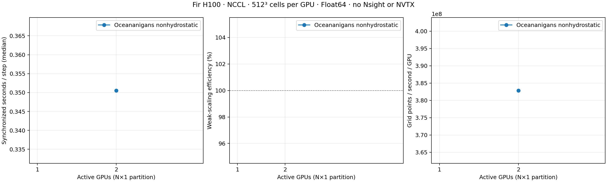

# Fir NCCL weak scaling: Oceananigans nonhydrostatic, 1 and 2 GPUs

Status: **INCOMPLETE; 3/6 cases validated.** Pending, failed, and unrun cases are excluded from performance metrics.

Oceananigans `NonhydrostaticModel` from the suite `rectilinear_buoyancy` workload, run by
`distributed_cbl_benchmark.jl --dynamics=oceananigans_nonhydrostatic`: Float64 RectilinearGrid, periodic x/y,
WENO5, one buoyancy tracer, RungeKutta3, distributed FFT pressure solver, Δt = 10 s, N×1 partitions, 512³ cells per GPU.
Two GPUs exchange halos and transpose the FFT solve with NCCL; MPI only launches ranks. One GPU has no inter-rank communication.
Each launch takes 10 untimed warmup steps and 100 timed steps; every case is launched three times.
**Pure performance benchmark: no Nsight capture and no NVTX instrumentation** (`--profile=false --nvtx=false`).
One Julia/BLAS/OpenMP thread per rank; CUDA memory pool disabled.

| GPUs | Global grid | Partition | Backend | Δt (s) |
|---:|---|---|---|---:|
| 1 | 512×512×512 | 1×1 | SERIAL | 10.0 |
| 2 | 1024×512×512 | 2×1 | NCCL | 10.0 |

GPU counts and per-GPU throughput refer to active MPI ranks, with one selected GPU per rank.
One Slurm allocation per GPU count runs its cases sequentially, with eight CPU cores per rank and one Julia thread.
The two-GPU allocation reserves all four H100s of one node so both ranks see every device (GPU peer copies);
only two ranks and two GPUs run the benchmark, and the unused GPUs are excluded from throughput and efficiency.
Each allocation has a three-hour limit; each case has a 50-minute cap, including startup and compilation.
An after-any CPU finalizer retains results and plots even if a GPU allocation fails.

| GPUs | Slurm job |
|---:|---|
| 1 | 5468404 |
| 2 | 5468405 |

Finalizer job: 5468406. Exact submission commands are in [submission.json](submission.json) and [allocations/](allocations/).

Recovery allocations: 1 GPUs: job 5641460. See [recovery notes](recovery.md).

| Dynamics | GPUs | Repeats | Median s/step | Min–max s/step | Points/s/GPU | Weak efficiency (%) |
|---|---:|---:|---:|---|---:|---:|
| Oceananigans nonhydrostatic | 2 | 3 | 0.3506 | 0.3504–0.3507 | 3.829e+08 |  |

| Case | GPUs | State | s/step | Evidence / error |
|---|---:|---|---:|---|
| oceananigans_nonhydrostatic_SERIAL_1g_1x1_r1 | 1 | not_run |  | Allocation ended before this case produced evidence |
| oceananigans_nonhydrostatic_SERIAL_1g_1x1_r2 | 1 | not_run |  | Allocation ended before this case produced evidence |
| oceananigans_nonhydrostatic_SERIAL_1g_1x1_r3 | 1 | not_run |  | Allocation ended before this case produced evidence |
| oceananigans_nonhydrostatic_NCCL_2g_2x1_r1 | 2 | validated | 3.507307e-01 | [case files](cases/oceananigans_nonhydrostatic_NCCL_2g_2x1_r1/) |
| oceananigans_nonhydrostatic_NCCL_2g_2x1_r2 | 2 | validated | 3.504498e-01 | [case files](cases/oceananigans_nonhydrostatic_NCCL_2g_2x1_r2/) |
| oceananigans_nonhydrostatic_NCCL_2g_2x1_r3 | 2 | validated | 3.505576e-01 | [case files](cases/oceananigans_nonhydrostatic_NCCL_2g_2x1_r3/) |

Timing includes final GPU synchronization and an MPI barrier and uses the slowest rank.
Weak efficiency is 100 × serial seconds/step ÷ distributed seconds/step, using a separate serial baseline for each dynamics and the median over repeats.
The fixed physical domain becomes finer in x as GPU count increases. These are step-throughput measurements at constant cells per GPU; simulated durations decrease with Δt.
Every accepted measurement requires the planned grid/dynamics/precision, distinct H100 GPU placement, the expected MPI communicator, positive finite timing, and finite prognostic and velocity fields on every rank.
Finite fields do not establish full numerical agreement with serial solutions. The min–max range spans the repeated launches.

[Source commit](provenance/source_commit.txt), [source archive](provenance/source.tar.gz), [frozen hashes](provenance/hashes.json),
[Julia environment](provenance/Manifest.toml), [MPI preferences](provenance/LocalPreferences.toml), [setup log](provenance/setup.log), and [case plan](plan.json).
Per-case directories retain exact commands, every rank's log and field validation, hardware details, final device-memory use, and five-second process-memory samples (which can miss peaks).

Julia 1.12.5; Breeze 0.15.0, Oceananigans 0.117.2, CUDA 6.4.2, MPI 0.20.29.

[Comparison CSV](comparison.csv) · [Vector SVG](weak_scaling.svg)
