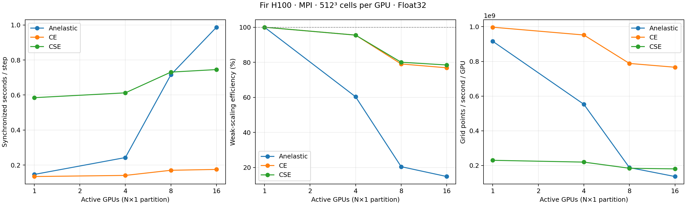

# Fir MPI weak scaling: anelastic, CE, CSE

Status: **INCOMPLETE; 12/15 cases validated.** Pending, failed, and unrun cases are excluded from performance metrics.

Full dry convective boundary layer, WENO5, Float32, deterministic smooth initial perturbations.
Fixed 12 km × 12 km × 3 km domain; N×1 partitions and 512³ cells per GPU.
All three dynamics halve Δt with each doubling of GPU count. CE is compressible explicit; CSE is compressible split-explicit.
10 untimed warmup steps and 500 timed steps per case, one timed window; CSE uses 12 acoustic substeps.
No Nsight or NVTX profiling. One Julia/BLAS/OpenMP thread per rank; CUDA memory pool disabled.

| GPUs | Global grid | Partition | Backend | Δt (s) |
|---:|---|---|---|---:|
| 1 | 512×512×512 | 1×1 | SERIAL | 0.01 |
| 2 | 1024×512×512 | 2×1 | MPI | 0.005 |
| 4 | 2048×512×512 | 4×1 | MPI | 0.0025 |
| 8 | 4096×512×512 | 8×1 | MPI | 0.00125 |
| 16 | 8192×512×512 | 16×1 | MPI | 0.000625 |

Five independent Slurm allocations request only the GPUs required for their scale.
Each runs anelastic, CE, and CSE sequentially on the same allocated GPUs, with eight CPU cores per rank and one Julia thread.
Each allocation has a three-hour limit; each case has a 50-minute cap, including startup and compilation.
An after-any CPU finalizer retains results and plots even if a GPU allocation fails.

| GPUs | Slurm job |
|---:|---|
| 1 | 3715781 |
| 2 | 3715782 |
| 4 | 3715783 |
| 8 | 3715784 |
| 16 | 3715785 |

Finalizer job: 3823309. Exact submission commands are in [submission.json](submission.json) and [allocations/](allocations/).

Recovery allocations: 2 GPUs: job 3819903, 2 GPUs: job 3823308. See [recovery notes](recovery.md).

| Dynamics | GPUs | State | s/step | Points/s/GPU | Weak efficiency (%) | Evidence / error |
|---|---:|---|---:|---:|---:|---|
| Anelastic | 1 | validated | 1.465498e-01 | 915850300.0 | 100.0 | [case files](cases/anelastic_SERIAL_1g_1x1/) |
| CE | 1 | validated | 1.346134e-01 | 997060400.0 | 100.0 | [case files](cases/compressible_explicit_SERIAL_1g_1x1/) |
| CSE | 1 | validated | 5.848549e-01 | 229488900.0 | 100.0 | [case files](cases/compressible_splitexplicit_SERIAL_1g_1x1/) |
| Anelastic | 2 | not_run |  |  |  | Allocation ended before this case produced evidence |
| CE | 2 | not_run |  |  |  | Allocation ended before this case produced evidence |
| CSE | 2 | not_run |  |  |  | Allocation ended before this case produced evidence |
| Anelastic | 4 | validated | 2.429220e-01 | 552513750.0 | 60.32792418965759 | [case files](cases/anelastic_MPI_4g_4x1/) |
| CE | 4 | validated | 1.409612e-01 | 952160500.0 | 95.49677499907776 | [case files](cases/compressible_explicit_MPI_4g_4x1/) |
| CSE | 4 | validated | 6.124700e-01 | 219141725.0 | 95.49119140529332 | [case files](cases/compressible_splitexplicit_MPI_4g_4x1/) |
| Anelastic | 8 | validated | 7.160144e-01 | 187451125.0 | 20.467437526396115 | [case files](cases/anelastic_MPI_8g_8x1/) |
| CE | 8 | validated | 1.703054e-01 | 788100250.0 | 79.04235567398332 | [case files](cases/compressible_explicit_MPI_8g_8x1/) |
| CSE | 8 | validated | 7.309038e-01 | 183632500.0 | 80.01804067785665 | [case files](cases/compressible_splitexplicit_MPI_8g_8x1/) |
| Anelastic | 16 | validated | 9.872682e-01 | 135948625.0 | 14.84397046314264 | [case files](cases/anelastic_MPI_16g_16x1/) |
| CE | 16 | validated | 1.751621e-01 | 766248750.0 | 76.85075709871029 | [case files](cases/compressible_explicit_MPI_16g_16x1/) |
| CSE | 16 | validated | 7.453969e-01 | 180062125.0 | 78.46221254743614 | [case files](cases/compressible_splitexplicit_MPI_16g_16x1/) |

Timing includes final GPU synchronization and an MPI barrier and uses the slowest rank.
Weak efficiency is 100 × serial seconds/step ÷ distributed seconds/step, using a separate serial baseline for each dynamics.
The fixed physical domain becomes finer in x as GPU count increases. These are step-throughput measurements at constant cells per GPU; simulated durations decrease with Δt.
Every accepted measurement requires the planned grid/dynamics/precision, distinct H100 GPU placement, the expected MPI communicator, positive finite timing, and finite prognostic and velocity fields on every rank.
Finite fields do not establish full numerical agreement with serial solutions. One timed window supplies no repeat-to-repeat uncertainty estimate.

[Source commit](provenance/source_commit.txt), [source archive](provenance/source.tar.gz), [frozen hashes](provenance/hashes.json),
[Julia environment](provenance/Manifest.toml), [MPI preferences](provenance/LocalPreferences.toml), [setup log](provenance/setup.log), and [case plan](plan.json).
Per-case directories retain exact commands, every rank's log and field validation, hardware details, final device-memory use, and five-second process-memory samples (which can miss peaks).

Julia 1.12.5; Breeze 0.15.0, Oceananigans 0.117.2, CUDA 6.4.2, MPI 0.20.29.

[Comparison CSV](comparison.csv) · [Vector SVG](weak_scaling.svg)
