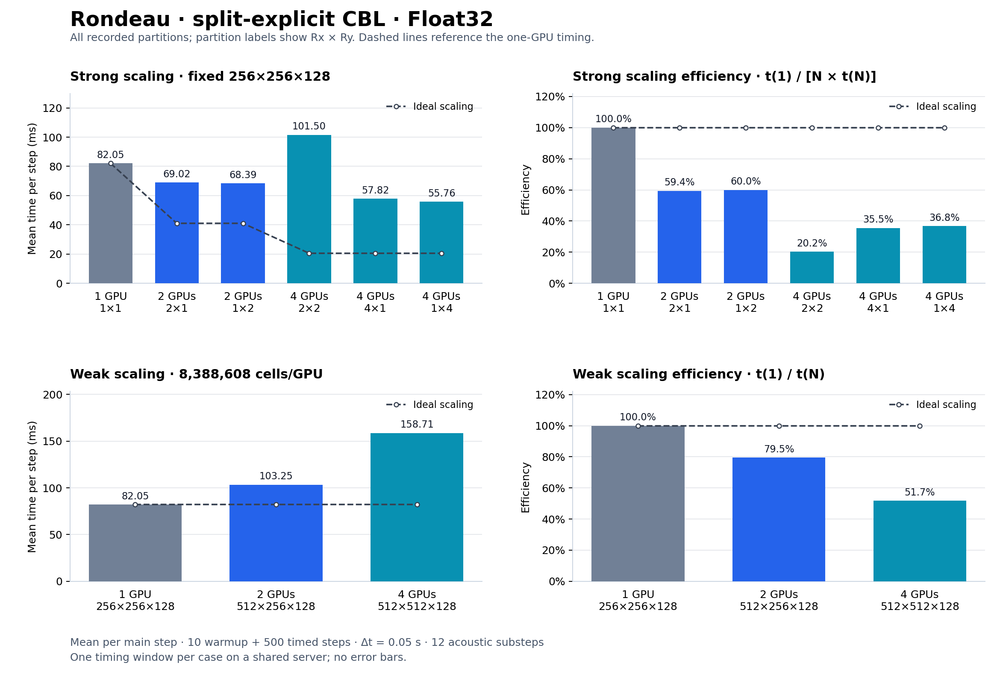

# Rondeau student-guide scaling results — 2026-11-04

**17 of 17 configured cases completed with exit status 0. Nine produced finite vertical velocity; all eight compressible-explicit cases produced NaNs at the prescribed settings. Their timings are excluded from performance comparisons.**

The [2026-11-05 rerun at Δt = 0.03 s](../student_guide_2026-11-05_dt0p03/README.md)
produced finite maximum vertical velocity in all 17 cases, with the same step
counts and other settings. The two runs cover different simulated durations.

[CSV](scaling.csv) · [Validation](validation.json) · [Runbook](../../../distributed/pelee_rondeau/rondeau_run.md) · [Copied commits](provenance/imported_commits.json)

The benchmark code is in this repository on `distributed-benchmark`, under `benchmarking/distributed/`. The student guide was followed through section 7. Section 8 experiments were not run.

## Split-explicit plots



The top panels compare all strong-scaling partitions on a fixed grid; the bottom
panels keep 8,388,608 cells per GPU. Dashed lines show ideal scaling relative to
the one-GPU result. [Vector SVG](split_explicit_scaling.svg).

Regenerate from the repository root:

```bash
python3 benchmarking/distributed/plot_split_explicit_results.py \
    benchmarking/results/rondeau/student_guide_2026-11-04/scaling.csv
```

## Measurement

Dry convective boundary layer, Float32, WENO5, no closure or microphysics. Each case uses 10 untimed warmup steps and one 500-step timed window at Δt = 0.05 s. Split-explicit dynamics uses 12 acoustic substeps. The reported time is the mean per main time step, using GPU synchronization, MPI barriers, and the maximum elapsed time across ranks. Construction, compilation warmup, output, and final checks are outside the timed window.

Rondeau: four NVIDIA A100-SXM4-40GB GPUs on one node. Julia 1.11.9, Breeze 0.14.0, Oceananigans 0.116.1, CUDA.jl 6.4.2, MPI.jl 0.20.29, system CUDA-aware Open MPI 4.1.7. These are single-window measurements on a shared server.

## Outcomes and scaling

Strong-scaling efficiency is t(1)/(N × t(N)); weak-scaling efficiency is t(1)/t(N). The one-GPU split-explicit case is the reference for both. Weak cases keep 8,388,608 cells per GPU. Anelastic is restricted to one GPU by the supplied driver.

| Dynamics | Series | GPUs | Global grid | Partition | ms/step | Efficiency | max abs w (m/s) | Log |
|---|---|---:|---|---|---:|---:|---:|---|
| anelastic | baseline | 1 | 256×256×128 | 1×1 | 22.617 | — | 0.1133 | [log](runs/logs/distributed_cbl_benchmark_20261104-114805.out) |
| explicit | baseline | 1 | 256×256×128 | 1×1 | invalid | — | NaN | [log](runs/logs/distributed_cbl_benchmark_20261104-115044.out) |
| explicit | strong | 2 | 256×256×128 | 2×1 | invalid | — | NaN | [log](runs/logs/distributed_cbl_benchmark_20261104-115319.out) |
| explicit | strong | 2 | 256×256×128 | 1×2 | invalid | — | NaN | [log](runs/logs/distributed_cbl_benchmark_20261104-115638.out) |
| explicit | strong | 4 | 256×256×128 | 2×2 | invalid | — | NaN | [log](runs/logs/distributed_cbl_benchmark_20261104-115956.out) |
| explicit | strong | 4 | 256×256×128 | 4×1 | invalid | — | NaN | [log](runs/logs/distributed_cbl_benchmark_20261104-120402.out) |
| explicit | strong | 4 | 256×256×128 | 1×4 | invalid | — | NaN | [log](runs/logs/distributed_cbl_benchmark_20261104-120725.out) |
| explicit | weak | 2 | 512×256×128 | 2×1 | invalid | — | NaN | [log](runs/logs/distributed_cbl_benchmark_20261104-121042.out) |
| explicit | weak | 4 | 512×512×128 | 2×2 | invalid | — | NaN | [log](runs/logs/distributed_cbl_benchmark_20261104-121403.out) |
| split explicit | baseline | 1 | 256×256×128 | 1×1 | 82.049 | 100.0% | 0.1196 | [log](runs/logs/distributed_cbl_benchmark_20261104-121812.out) |
| split explicit | strong | 2 | 256×256×128 | 2×1 | 69.021 | 59.4% | 0.1159 | [log](runs/logs/distributed_cbl_benchmark_20261104-122145.out) |
| split explicit | strong | 2 | 256×256×128 | 1×2 | 68.392 | 60.0% | 0.1173 | [log](runs/logs/distributed_cbl_benchmark_20261104-122612.out) |
| split explicit | strong | 4 | 256×256×128 | 2×2 | 101.504 | 20.2% | 0.1132 | [log](runs/logs/distributed_cbl_benchmark_20261104-123038.out) |
| split explicit | strong | 4 | 256×256×128 | 4×1 | 57.823 | 35.5% | 0.1175 | [log](runs/logs/primary_4gpu_4x1_256x256x128_20261104-124654.out) |
| split explicit | strong | 4 | 256×256×128 | 1×4 | 55.761 | 36.8% | 0.1182 | [log](runs/logs/primary_4gpu_1x4_256x256x128_20261104-125119.out) |
| split explicit | weak | 2 | 512×256×128 | 2×1 | 103.254 | 79.5% | 0.1196 | [log](runs/logs/primary_2gpu_2x1_512x256x128_20261104-125546.out) |
| split explicit | weak | 4 | 512×512×128 | 2×2 | 158.710 | 51.7% | 0.1422 | [log](runs/logs/primary_4gpu_2x2_512x512x128_20261104-130031.out) |

All explicit cases finished their loops but failed the guide's finite-output criterion. The predefined sweep was run without additional section 8 experiments. The raw CSV retains the emitted numbers and NaNs for audit.

## Validation and execution record

Eight platform checks passed: single system MPI, CUDA-aware GPU communication, distributed-versus-serial derivatives, and NetCDF/JLD2 output, each on two and four GPUs. Live process observations verified four distinct GPU assignments, one Julia thread per rank, and Julia 1.11.9. The primary-repository environment check loads Breeze from `/u/ajtse/Breeze.jl/src/Breeze.jl`.

The benchmark checks finiteness of maximum vertical velocity only. Full Breeze distributed-versus-serial field agreement was not tested by this workflow. Process success is reported separately from finite output.

The first 13 cases ran using Francis's source at `72c9e851105cf0017a16fb3c122a4170f82c5694`. Its seven feature commits and three main-line prerequisites were copied with `git cherry-pick -x`; the imported tip `96a570a1` has an identical tracked file tree. The remaining four cases ran from this primary repository. The model, driver, packages, and timing settings were unchanged. [Commit mapping](provenance/imported_commits.json) and [migration record](execution/migration.json) preserve the transition.

Installed Julia and platform software now live under `/u/ajtse/software/`. The task-created hidden Breeze clone was removed. Original log paths remain in historical logs; they are execution evidence rather than current setup instructions. Current commands are in the [Rondeau runbook](../../../distributed/pelee_rondeau/rondeau_run.md), with the [continuation commands](execution/continuation_commands.txt) retained verbatim.

The host's inherited SSH startup variables caused early detached-shell attempts to select Julia 1.12.7. Those attempts were stopped or excluded. Accepted runs use the verified Julia 1.11.9 environment. The introductory one-GPU 300-step explicit run had finite but large max abs w (48.18 m/s); the two-GPU 100-step example had max abs w 0.0342 m/s. They are recorded separately in [first-runs.csv](first-runs.csv) and are not scaling references.

Logs contain CUDA library-path warnings and PMIx cleanup messages. Accepted case commands exited with status 0 and the communication checks passed; these messages remain in the evidence. No cause for the explicit instability is asserted here.

Retained text logs normalize trailing whitespace and line endings. [raw_logs.zip](raw_logs.zip) preserves the original log bytes, including excluded setup attempts; [log_originals.json](log_originals.json) records their sizes and SHA-256 checksums. Environment snapshots are under `provenance/` and are records of the run, not standalone projects to activate.
