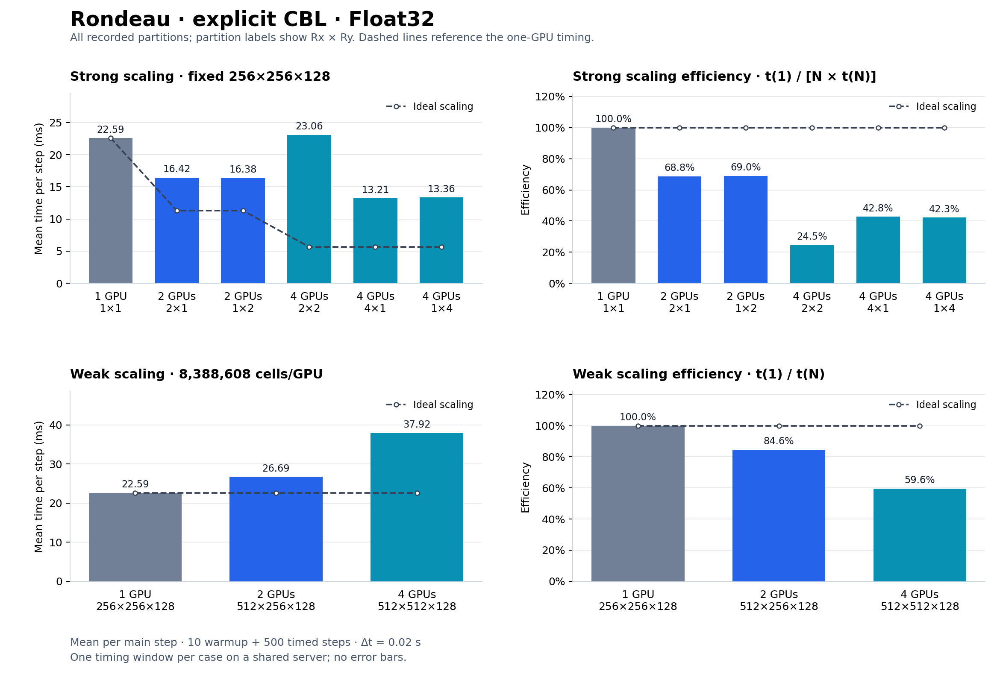
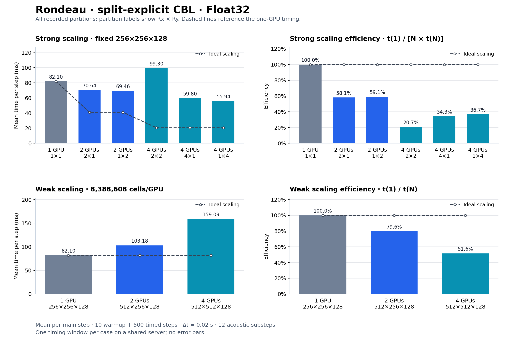

# Rondeau scaling rerun — Δt = 0.02 s — 2026-11-05

**17 of 17 cases completed with exit status 0; 17 produced finite maximum vertical velocity and 0 produced non-finite values.**

[CSV](scaling.csv) · [Comparison CSV](comparison.csv) · [Validation](validation.json) · [Previous Δt = 0.03 results](../student_guide_2026-11-05_dt0p03/README.md)

This repeats the previous 17-case sweep with the time step changed from 0.03 to 0.02 seconds. Grid sizes, partitions, Float32 precision, 10 warmup steps, 500 timed steps, and 12 split-explicit acoustic substeps are unchanged. No other section 8 experiments were run.

## Measurement

Dry convective boundary layer using AtmosphereModel, WENO5, no turbulence closure or microphysics. Each case measures one 500-step window. The driver synchronizes the GPU, uses MPI barriers, and reports the maximum elapsed time across ranks divided by the step count. Model construction, compilation, warmup, and final checks are outside the timer.

The timed window covers **10 simulated seconds** at 0.02, compared with **15 simulated seconds** at 0.03. Including warmup, final velocity checks occur at about 10.2 and 15.3 simulated seconds. The driver uses random initial perturbations without a fixed seed. Finite maximum vertical velocity passes the driver's limited check; it does not establish full-field finiteness, numerical accuracy, or long-duration stability. Non-finite cases are excluded from performance comparisons. Timings are single-window observations on a shared server, with no error bars.

Rondeau has four NVIDIA A100-SXM4-40GB GPUs. This run uses Julia 1.11.9 and system CUDA-aware Open MPI 4.1.7. Project, Manifest, and MPI preferences match the previous run byte for byte. The scientific source, benchmark driver, and sweep script are unchanged. Four live MPI workers were verified to use four distinct GPUs, one Julia thread per rank, and CUDA memory pooling disabled.

## Results

| Dynamics | GPUs | Global grid | Partition | ms/step at 0.03 | ms/step at 0.02 | max abs w at 0.02 (m/s) | Log |
|---|---:|---|---|---:|---:|---:|---|
| anelastic | 1 | 256×256×128 | 1×1 | 22.276 | 22.748 | 0.04998 | [log](runs/logs/distributed_cbl_benchmark_20261105-084858.out) |
| explicit | 1 | 256×256×128 | 1×1 | 22.597 | 22.588 | 0.05089 | [log](runs/logs/distributed_cbl_benchmark_20261105-085135.out) |
| explicit | 2 | 256×256×128 | 2×1 | 17.035 | 16.425 | 0.05446 | [log](runs/logs/distributed_cbl_benchmark_20261105-085413.out) |
| explicit | 2 | 256×256×128 | 1×2 | 16.450 | 16.380 | 0.05224 | [log](runs/logs/distributed_cbl_benchmark_20261105-085729.out) |
| explicit | 4 | 256×256×128 | 2×2 | 21.930 | 23.062 | 0.05021 | [log](runs/logs/distributed_cbl_benchmark_20261105-090046.out) |
| explicit | 4 | 256×256×128 | 4×1 | 14.170 | 13.208 | 0.05166 | [log](runs/logs/distributed_cbl_benchmark_20261105-090445.out) |
| explicit | 4 | 256×256×128 | 1×4 | 12.701 | 13.357 | 0.05141 | [log](runs/logs/distributed_cbl_benchmark_20261105-090804.out) |
| explicit | 2 | 512×256×128 | 2×1 | 26.676 | 26.689 | 0.05530 | [log](runs/logs/distributed_cbl_benchmark_20261105-091125.out) |
| explicit | 4 | 512×512×128 | 2×2 | 38.588 | 37.917 | 0.06268 | [log](runs/logs/distributed_cbl_benchmark_20261105-091449.out) |
| split explicit | 1 | 256×256×128 | 1×1 | 82.015 | 82.097 | 0.05451 | [log](runs/logs/distributed_cbl_benchmark_20261105-091857.out) |
| split explicit | 2 | 256×256×128 | 2×1 | 69.199 | 70.638 | 0.05151 | [log](runs/logs/distributed_cbl_benchmark_20261105-092231.out) |
| split explicit | 2 | 256×256×128 | 1×2 | 68.543 | 69.461 | 0.05306 | [log](runs/logs/distributed_cbl_benchmark_20261105-092702.out) |
| split explicit | 4 | 256×256×128 | 2×2 | 98.918 | 99.303 | 0.05469 | [log](runs/logs/distributed_cbl_benchmark_20261105-093132.out) |
| split explicit | 4 | 256×256×128 | 4×1 | 58.477 | 59.802 | 0.05351 | [log](runs/logs/distributed_cbl_benchmark_20261105-093711.out) |
| split explicit | 4 | 256×256×128 | 1×4 | 56.887 | 55.943 | 0.05641 | [log](runs/logs/distributed_cbl_benchmark_20261105-094140.out) |
| split explicit | 2 | 512×256×128 | 2×1 | 103.132 | 103.177 | 0.05804 | [log](runs/logs/distributed_cbl_benchmark_20261105-094614.out) |
| split explicit | 4 | 512×512×128 | 2×2 | 158.555 | 159.087 | 0.06666 | [log](runs/logs/distributed_cbl_benchmark_20261105-095101.out) |

## Reproduction and evidence

[execution/run.sh](execution/run.sh) records the complete environment and invocation. It uses the primary `/u/ajtse/Breeze.jl` repository on `distributed-benchmark`. After sourcing that environment, run from a fresh `runs/` directory:

```bash
bash "$BREEZE_DISTRIBUTED_DIR/pelee_rondeau/run_scaling.sh" \
    --time_steps=500 --time_step=0.02 --max_gpus=4 \
    --results_file="$OCEAN_RESULTS_ROOT/scaling.csv"
```

Use a fresh results directory and CSV to avoid duplicate rows. [execution/sweep.log](execution/sweep.log) records commands and case exit statuses. Direct post-run checks cover unique case coverage, geometry, actual Δt in logs, CSV/log agreement, timing/throughput consistency, unchanged source hashes, environment identity, and live rank observations. `provenance/` retains package and source snapshots. The recording wrapper and all 17 case commands exited with status 0.

Text logs normalize trailing whitespace. [raw_logs.zip](raw_logs.zip) preserves their original bytes; [log_originals.json](log_originals.json) records sizes and SHA-256 hashes. CUDA library-path warnings and PMIx cleanup messages are retained. No additional MPI numerical-comparison tests were run for this timestep-only rerun.

## Explicit scaling



The top panels use a fixed 256×256×128 global grid; the bottom panels keep 8,388,608 cells per GPU. Strong efficiency is t(1)/(N × t(N)); weak efficiency is t(1)/t(N). All recorded partitions are shown. [Vector SVG](explicit_scaling.svg).

```bash
python3 benchmarking/distributed/plot_split_explicit_results.py \
    benchmarking/results/rondeau/student_guide_2026-11-05_dt0p02/scaling.csv \
    --dynamics compressible_explicit --time-step=0.02
```

## Split-explicit scaling



The top panels use a fixed 256×256×128 global grid; the bottom panels keep 8,388,608 cells per GPU. Strong efficiency is t(1)/(N × t(N)); weak efficiency is t(1)/t(N). All recorded partitions are shown. [Vector SVG](split_explicit_scaling.svg).

```bash
python3 benchmarking/distributed/plot_split_explicit_results.py \
    benchmarking/results/rondeau/student_guide_2026-11-05_dt0p02/scaling.csv \
    --time-step=0.02
```
