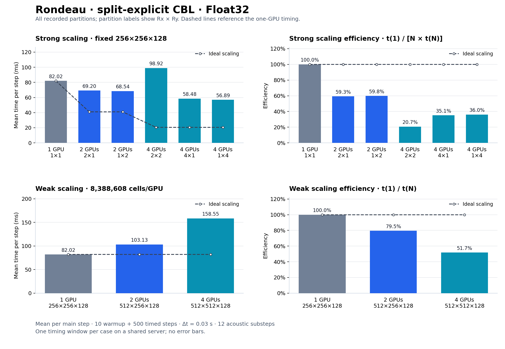

# Rondeau scaling rerun — Δt = 0.03 s — 2026-11-05

**17 of 17 cases completed with exit status 0; 17 produced finite maximum vertical velocity and 0 produced non-finite values.**

[CSV](scaling.csv) · [Comparison CSV](comparison.csv) · [Validation](validation.json) · [Previous Δt = 0.05 results](../student_guide_2026-11-04/README.md)

The user requested the original 17-case sweep again with the time step changed from 0.05 to 0.03 seconds. Grid sizes, partitions, Float32 precision, 10 warmup steps, 500 timed steps, and 12 split-explicit acoustic substeps are unchanged. No other section 8 experiments were run.

## Measurement and comparison

Dry convective boundary layer with WENO5, no turbulence closure or microphysics. Each case measures one 500-step window after compilation warmup. The driver synchronizes the GPU, uses MPI barriers, and reports the maximum elapsed time across ranks divided by the number of steps. Model construction, warmup, and final checks are outside the timer. Timings are single-window observations on a shared server, with no error bars.

The timed window covers **15 simulated seconds** at 0.03, compared with **25 simulated seconds** at 0.05. Including warmup, final velocity values are measured at about 15.3 and 25.5 simulated seconds. The case uses random initial perturbations and the driver does not fix a seed, so reruns also do not preserve an identical initial realization. Finite maximum vertical velocity passes the driver's limited check; it does not establish full-field finiteness, numerical accuracy, or long-duration stability. Non-finite cases are excluded from performance comparisons; their emitted timing numbers remain in the raw CSV.

Rondeau: four NVIDIA A100-SXM4-40GB GPUs, Julia 1.11.9, Breeze 0.14.0, Oceananigans 0.116.1, CUDA.jl 6.4.2, MPI.jl 0.20.29, system CUDA-aware Open MPI 4.1.7. Project, Manifest, and MPI preferences match the previous run byte for byte. The scientific model and Julia benchmark driver are unchanged. The sweep script now accepts `--time_step`, retaining its default of 0.05.

## Results

| Dynamics | GPUs | Global grid | Partition | ms/step at 0.05 | ms/step at 0.03 | max abs w at 0.03 (m/s) | Log |
|---|---:|---|---|---:|---:|---:|---|
| anelastic | 1 | 256×256×128 | 1×1 | 22.617 | 22.276 | 0.07337 | [log](runs/logs/distributed_cbl_benchmark_20261105-003755.out) |
| explicit | 1 | 256×256×128 | 1×1 | invalid | 22.597 | 0.07326 | [log](runs/logs/distributed_cbl_benchmark_20261105-004032.out) |
| explicit | 2 | 256×256×128 | 2×1 | invalid | 17.035 | 0.07102 | [log](runs/logs/distributed_cbl_benchmark_20261105-004307.out) |
| explicit | 2 | 256×256×128 | 1×2 | invalid | 16.450 | 0.07353 | [log](runs/logs/distributed_cbl_benchmark_20261105-004625.out) |
| explicit | 4 | 256×256×128 | 2×2 | invalid | 21.930 | 0.07404 | [log](runs/logs/distributed_cbl_benchmark_20261105-004942.out) |
| explicit | 4 | 256×256×128 | 4×1 | invalid | 14.170 | 0.06944 | [log](runs/logs/distributed_cbl_benchmark_20261105-005343.out) |
| explicit | 4 | 256×256×128 | 1×4 | invalid | 12.701 | 0.07161 | [log](runs/logs/distributed_cbl_benchmark_20261105-005706.out) |
| explicit | 2 | 512×256×128 | 2×1 | invalid | 26.676 | 0.07542 | [log](runs/logs/distributed_cbl_benchmark_20261105-010023.out) |
| explicit | 4 | 512×512×128 | 2×2 | invalid | 38.588 | 0.09102 | [log](runs/logs/distributed_cbl_benchmark_20261105-010344.out) |
| split explicit | 1 | 256×256×128 | 1×1 | 82.049 | 82.015 | 0.07640 | [log](runs/logs/distributed_cbl_benchmark_20261105-010800.out) |
| split explicit | 2 | 256×256×128 | 2×1 | 69.021 | 69.199 | 0.08024 | [log](runs/logs/distributed_cbl_benchmark_20261105-011133.out) |
| split explicit | 2 | 256×256×128 | 1×2 | 68.392 | 68.543 | 0.07686 | [log](runs/logs/distributed_cbl_benchmark_20261105-011602.out) |
| split explicit | 4 | 256×256×128 | 2×2 | 101.504 | 98.918 | 0.07636 | [log](runs/logs/distributed_cbl_benchmark_20261105-012031.out) |
| split explicit | 4 | 256×256×128 | 4×1 | 57.823 | 58.477 | 0.07617 | [log](runs/logs/distributed_cbl_benchmark_20261105-012604.out) |
| split explicit | 4 | 256×256×128 | 1×4 | 55.761 | 56.887 | 0.08144 | [log](runs/logs/distributed_cbl_benchmark_20261105-013035.out) |
| split explicit | 2 | 512×256×128 | 2×1 | 103.254 | 103.132 | 0.07440 | [log](runs/logs/distributed_cbl_benchmark_20261105-013506.out) |
| split explicit | 4 | 512×512×128 | 2×2 | 158.710 | 158.555 | 0.08833 | [log](runs/logs/distributed_cbl_benchmark_20261105-013952.out) |

## Reproduction and evidence

The complete environment and invocation are recorded in [execution/run.sh](execution/run.sh). From the repository root, after sourcing the environment in that file, the sweep command is:

```bash
bash benchmarking/distributed/pelee_rondeau/run_scaling.sh \
    --time_steps=500 --time_step=0.03 --max_gpus=4 \
    --results_file="$OCEAN_RESULTS_ROOT/scaling.csv"
```

Use a fresh results directory and CSV for a new run. Logs record `--time_step=0.03`, the driver's actual Δt, and terminal exit status for every case. [Validation script](execution/validate.py) checks unique case coverage, geometry, CSV/log agreement, timing/throughput consistency, source hashes, and package environment identity. Provenance snapshots are under `provenance/`. The run uses the primary `/u/ajtse/Breeze.jl` repository on `distributed-benchmark`.

All 17 benchmark commands exited with status 0. The outer recording wrapper exited with status 2 after the sweep: its script was edited while Bash was waiting for the sweep, shifting the remaining input position and causing a parse error on the final timestamp command. The retained script passes syntax validation. The completion timestamp was recovered from the last case's exit-status footer. [Wrapper status](execution/wrapper_status.json) and the original sweep log preserve this bookkeeping failure separately from benchmark outcomes.

Text logs normalize trailing whitespace. [raw_logs.zip](raw_logs.zip) retains the original log bytes, with sizes and SHA-256 hashes in [log_originals.json](log_originals.json). CUDA library-path warnings and PMIx cleanup messages are retained in the logs. No additional MPI numerical-validation tests were run for this timestep-only rerun.

## Split-explicit scaling



The top panels use a fixed 256×256×128 global grid; the bottom panels keep 8,388,608 cells per GPU. Strong efficiency is t(1)/(N × t(N)); weak efficiency is t(1)/t(N). All recorded partitions are shown. [Vector SVG](split_explicit_scaling.svg).

```bash
python3 benchmarking/distributed/plot_split_explicit_results.py \
    benchmarking/results/rondeau/student_guide_2026-11-05_dt0p03/scaling.csv \
    --time-step=0.03
```
