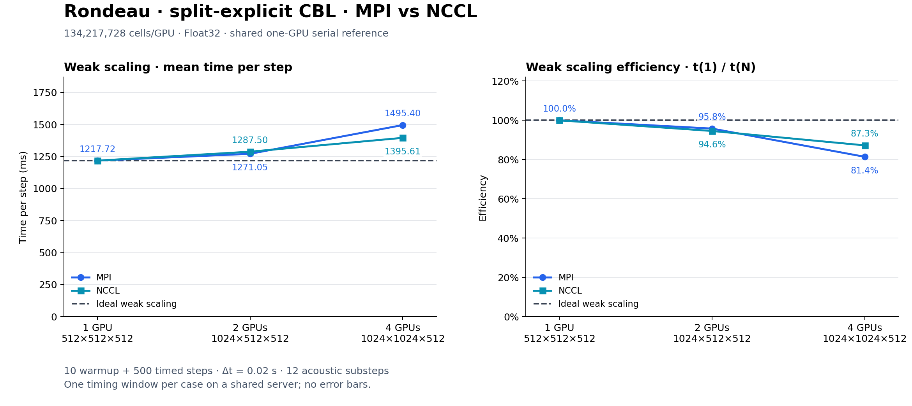

# Rondeau MPI/NCCL weak scaling — 2026-11-08

**Complete: all 10 cases finished.** The four-GPU cases ran on November 9,
03:03–03:52 Toronto time, after the controller waited for free GPUs.
The plot and metrics now include **1, 2, and 4 GPUs**. The earlier six-case
[progress snapshot](progress_snapshot_6_cases.json) is retained as history.

Five split-explicit cases passed the final prognostic/velocity field-finiteness
check. All five explicit cases produced non-finite fields at the confirmed
**Δt = 0.02 s** and are excluded from performance metrics and plots.
Their raw timings and logs are retained. Process completion and numerical
validity are reported separately.

## Split-explicit results

| GPUs | Global grid | MPI s/step | NCCL s/step | MPI weak efficiency | NCCL weak efficiency | MPI time / NCCL time |
|------|-------------|------------|-------------|---------------------|----------------------|----------------------|
| 1 (shared serial) | 512 × 512 × 512 | 1.217721 | 1.217721 | 100.0% | 100.0% | — |
| 2 | 1024 × 512 × 512 | 1.271046 | 1.287500 | 95.8% | 94.6% | 0.987× |
| 4 | 1024 × 1024 × 512 | 1.495404 | 1.395613 | 81.4% | 87.3% | 1.072× |

On four GPUs, NCCL took **6.67% less time per step** than MPI
(1.072× throughput). On two GPUs, NCCL took 1.29% longer.
Weak efficiency is **100 × t(1) / t(N)**. These are single windows on a shared
server, without repeats or error bars; they do not establish statistical
significance. Initial random perturbations are unseeded.



[SVG](split_explicit_weak_mpi_nccl.svg) · [PNG](split_explicit_weak_mpi_nccl.png)

## Configuration

Both compressible dynamics use Float32, WENO5, the existing dry CBL physics,
Δt = 0.02 s, 10 warmup steps, and 500 timed main steps (10 simulated seconds).
Split-explicit keeps the existing 12-acoustic-substep setting.

| GPUs | Global grid | Partition (Rx × Ry) | Local cells/GPU |
|------|-------------|---------------------|-----------------|
| 1 | 512 × 512 × 512 | 1 × 1 | 512³ |
| 2 | 1024 × 512 × 512 | 2 × 1 | 512³ |
| 4 | 1024 × 1024 × 512 | 2 × 2 | 512³ |

The physical domain stays 12 km × 12 km × 3 km, so global resolution increases
with GPU count. One plain-GPU serial baseline per model is shared by MPI and
NCCL. Anelastic is omitted because this driver does not support its distributed
pressure solve. The confirmed step size was kept for all cases; no smaller-step
retry is mixed into this study.

## All cases and observed memory

| Dynamics | Backend | GPUs | Final fields | Peak device memory/GPU (GiB) | Log |
|----------|---------|------|--------------|------------------------------|-----|
| Explicit | SERIAL | 1 | **Non-finite; excluded** | 16.41 | [Full log](runs/logs/weak_compressible_explicit_SERIAL_1g_20261108-192559.out) |
| Split-explicit | SERIAL | 1 | Finite | 25.94 | [Full log](runs/logs/weak_compressible_splitexplicit_SERIAL_1g_20261108-193125.out) |
| Explicit | MPI | 2 | **Non-finite; excluded** | 16.56 / 16.56 | [Full log](runs/logs/weak_compressible_explicit_MPI_2g_20261108-194448.out) |
| Explicit | NCCL | 2 | **Non-finite; excluded** | 16.88 / 17.41 | [Full log](runs/logs/weak_compressible_explicit_NCCL_2g_20261108-195105.out) |
| Split-explicit | MPI | 2 | Finite | 26.49 / 26.49 | [Full log](runs/logs/weak_compressible_splitexplicit_MPI_2g_20261108-195731.out) |
| Split-explicit | NCCL | 2 | Finite | 26.81 / 26.81 | [Full log](runs/logs/weak_compressible_splitexplicit_NCCL_2g_20261108-201226.out) |
| Explicit | MPI | 4 | **Non-finite; excluded** | 17.25 / 17.25 / 17.25 / 17.25 | [Full log](runs/logs/weak_compressible_explicit_MPI_4g_20261109-030316.out) |
| Explicit | NCCL | 4 | **Non-finite; excluded** | 17.90 / 17.90 / 17.90 / 17.90 | [Full log](runs/logs/weak_compressible_explicit_NCCL_4g_20261109-031023.out) |
| Split-explicit | MPI | 4 | Finite | 27.58 / 27.58 / 27.58 / 27.58 | [Full log](runs/logs/weak_compressible_splitexplicit_MPI_4g_20261109-031741.out) |
| Split-explicit | NCCL | 4 | Finite | 28.77 / 28.77 / 28.77 / 28.77 | [Full log](runs/logs/weak_compressible_splitexplicit_NCCL_4g_20261109-033530.out) |

Memory is sampled every 10 seconds and includes the CUDA context. These are
observed lower bounds on peak usage. Serial used physical GPU 1; two-rank cases
used GPUs 1 and 2; four-rank cases used GPUs 0–3. The controller waited for
selected devices to be free. Samples show no foreign compute process on a
selected GPU during any measured case. Other host activity was not controlled.
All ten workloads exited zero; field validity is checked separately.

## Timing and transport

The tracked [driver](../../../distributed/distributed_cbl_benchmark.jl) warms up
before timing, synchronizes CUDA and MPI at each window boundary, and reports
the maximum rank elapsed time divided by 500. Construction, warmup/JIT, and final
field checks are excluded. Buffered logs can delay live stage markers.

NCCL cases selected the actual NCCLDistributed architecture and NCCLCommunicator,
with libnccl.so.2.32.3 mapped in every worker. MPI remains the launcher and handles
setup, barriers, scalar reductions, and control. Serial uses plain GPU().
NCCL_DEBUG was WARN for timings and INFO for halo/model validation.

## Validation

- Exact coverage of both models, shared serial baselines, and MPI/NCCL on two
  and four GPUs; matching commands, exit statuses, grids, partitions, CSV/log
  values, timing arithmetic, selected GPU placement, and sampled memory peaks.
- Final interior values of every prognostic and velocity field were checked
  on every rank. Invalid cases have blank derived metrics in comparison.csv.
- Upstream NCCL halo-value probes passed on two and four GPUs: center and all
  three face fields, periodic x/y, bounded z, halo width five, and corner samples.
  The probes use default Float64; model pilots and benchmarks use Float32.
- Small serial split-explicit and two-GPU NCCL split-explicit/explicit pilots
  retained finite fields after two warmup and two timed steps at Δt = 0.02 s.
- Worker snapshots verify one Julia thread per rank, distinct selected GPUs,
  system CUDA-aware MPI, and loaded NCCL libraries in NCCL cases.
- Scientific source, driver, platform launcher, root project, and benchmark
  environment match their frozen snapshots. Existing resolved package versions
  and source hashes were preserved; only NCCL and NCCL_jll were added.
- Invalid communication choices and incompatible legacy CSV headers are rejected.
  Legacy plots regenerated byte-identically. Current comparison values, labels,
  curve-order annotations, PNG/SVG integrity, and label bounds are verified.
  Plot parsing rejects invalid explicit fields and unselected mixed backends.

The first two-GPU halo invocation lacked an explicit import of fill_halo_regions!
and failed before validation. Its [log](validation/attempt_1_missing_import_nccl_halo_2.log)
is retained; the corrected invocation passed. Full-model serial/MPI/NCCL numerical
agreement has not been tested.

Logs retain system CUDA library-path warnings, Open MPI NFS shared-memory
warnings, PMIx cleanup messages, and NCCL warnings that the RMA/socket path
requires unavailable GDRCopy. Halo probes record P2P/CUMEM/read channels and pass.
Workload exit statuses and final field checks are verified separately.

## Reproduction and evidence

Driver support: ed770fd8. The current plotting source is identified by its
[SHA-256](provenance/plot_source_sha256.txt). Julia 1.11.9, CUDA.jl 6.4.2,
MPI.jl 0.20.29, Oceananigans.jl 0.116.1, Open MPI 4.1.7, NCCL.jl 0.1.3,
NCCL library 2.32.3; NVIDIA A100-SXM4-40GB GPUs. The root project and scientific
code were unchanged.

- [Completed study and validation](study.json), [raw measurements](measurements.csv),
  [validated metrics](comparison.csv), [device/process samples](memory_samples.csv).
- [Workload commands/environment](execution/commands.log),
  [launcher log](execution/sweep.log),
  [completed controller record](execution/controller_process.json).
- [Validation commands](validation/commands.log),
  [two-GPU halo test](validation/nccl_halo_2.log),
  [four-GPU halo test](validation/nccl_halo_4.log),
  [model pilot measurements](validation/pilot.csv),
  [plot checks](validation/plot_checks.log),
  [final verification](execution/final_validation.log).
- [Environment](provenance/environment.log), [manifest](provenance/Manifest.toml),
  [package changes](provenance/package_changes.toml),
  [source hashes](provenance/source_sha256.txt),
  [driver revision](provenance/source_commit.txt).
- [Original log bytes](original_logs.zip) and [archive hashes](original_logs_sha256.json).
  Display logs have ANSI codes and trailing whitespace removed; the archive
  preserves their original bytes.

The sweep and its controller have finished; no cases remain queued.

Regenerate the comparison plot from the repository root:

```bash
python3 benchmarking/distributed/plot_split_explicit_results.py \
  benchmarking/results/rondeau/weak_scaling_mpi_nccl_2026-11-08_dt0p02/measurements.csv \
  --dynamics=compressible_splitexplicit --compare-comm --time-step=0.02
```
