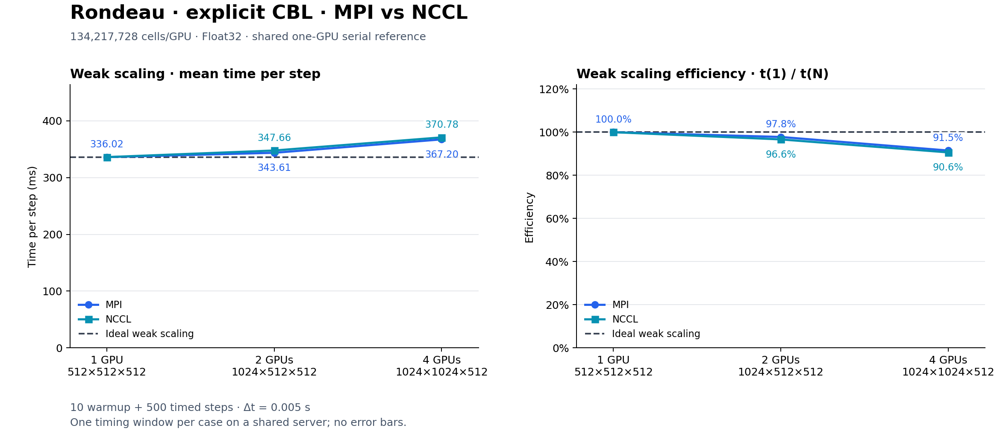
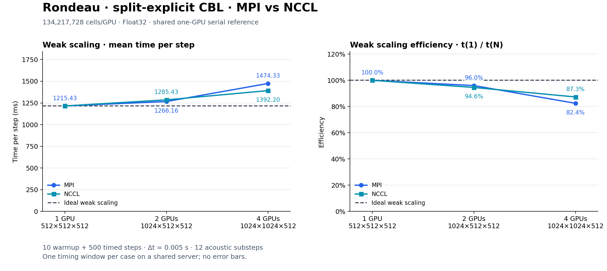
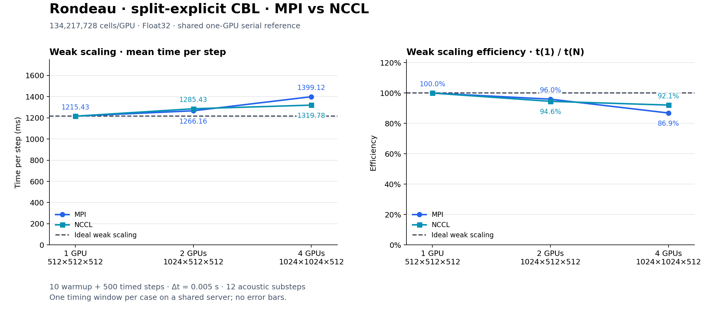
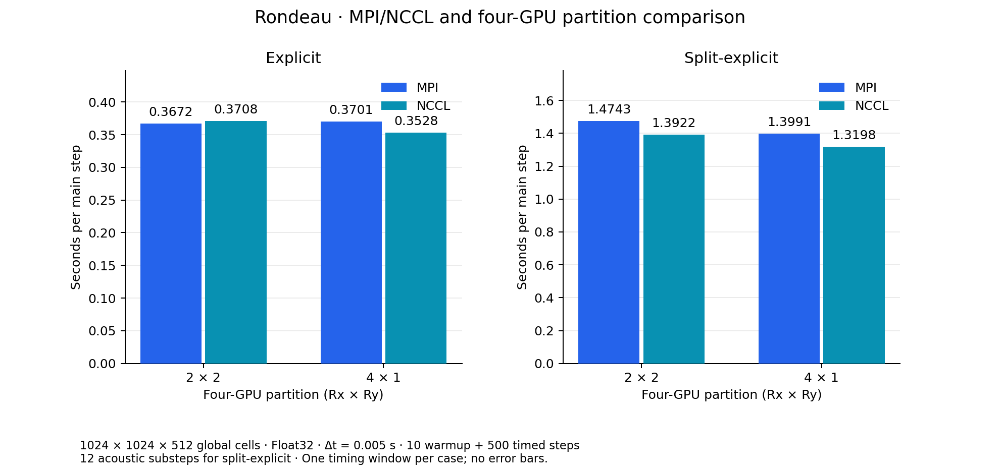

# Rondeau MPI/NCCL weak scaling at Δt = 0.005 s

Updated 2026-11-10 03:51 EST. **14/14 cases complete; 14 with finite fields.**

Both compressible dynamics are rerun from the previous 0.02-second study. The only physics/timing change is
Δt = 0.005 s. The added four-GPU cases compare partitions 2×2 and 4×1 on the same global grid.

Float32, WENO5, full dry CBL setup, fixed 12 km × 12 km × 3 km domain, 10 warmup steps, and 500 timed main steps
(2.5 simulated seconds) are retained. Split-explicit uses 12 acoustic substeps. Initial perturbations are unseeded.

| GPUs | Global grid | Partition | Cells/GPU |
|---|---|---|---|
| 1 | 512×512×512 | 1×1 | 512³ |
| 2 | 1024×512×512 | 2×1 | 512³ |
| 4 | 1024×1024×512 | 2×2 or 4×1 | 512³ |

The 4×1 layout has local grids 256×1024×512; 2×2 has 512×512×512. Both retain 512³ cells per rank.

## Measurements

| Dynamics | Backend | GPUs | Partition | s/step | Weak efficiency | Final fields |
|---|---|---|---|---|---|---|
| Explicit | SERIAL | 1 | 1x1 | 0.336017 | 100.0% | Finite |
| Split-explicit | SERIAL | 1 | 1x1 | 1.215426 | 100.0% | Finite |
| Explicit | MPI | 2 | 2x1 | 0.343606 | 97.8% | Finite |
| Explicit | NCCL | 2 | 2x1 | 0.347664 | 96.6% | Finite |
| Split-explicit | MPI | 2 | 2x1 | 1.266162 | 96.0% | Finite |
| Split-explicit | NCCL | 2 | 2x1 | 1.285433 | 94.6% | Finite |
| Explicit | MPI | 4 | 2x2 | 0.367202 | 91.5% | Finite |
| Explicit | NCCL | 4 | 2x2 | 0.370777 | 90.6% | Finite |
| Split-explicit | MPI | 4 | 2x2 | 1.474333 | 82.4% | Finite |
| Split-explicit | NCCL | 4 | 2x2 | 1.392204 | 87.3% | Finite |
| Explicit | MPI | 4 | 4x1 | 0.370088 | 90.8% | Finite |
| Explicit | NCCL | 4 | 4x1 | 0.352779 | 95.2% | Finite |
| Split-explicit | MPI | 4 | 4x1 | 1.399117 | 86.9% | Finite |
| Split-explicit | NCCL | 4 | 4x1 | 1.319781 | 92.1% | Finite |

Weak efficiency is 100 × serial time / distributed time. The shared one-GPU baseline uses plain GPU().
Times are the maximum rank elapsed time divided by 500, with CUDA synchronization and MPI barriers at
window boundaries. Construction/JIT/warmup and field validation are excluded. There is one timing window
per case on a shared server, without repeats or error bars; differences do not establish statistical significance.

## Four-GPU comparison

| Dynamics | Backend | 2×2 s/step | 4×1 s/step | 2×2 time / 4×1 time |
|---|---|---|---|---|
| Explicit | MPI | 0.367202 | 0.370088 | 0.992× |
| Explicit | NCCL | 0.370777 | 0.352779 | 1.051× |
| Split-explicit | MPI | 1.474333 | 1.399117 | 1.054× |
| Split-explicit | NCCL | 1.392204 | 1.319781 | 1.055× |



[Explicit weak scaling; four-GPU partition 2x2: SVG](explicit_weak_mpi_nccl_2x2.svg)


[Explicit weak scaling; four-GPU partition 4x1: SVG](explicit_weak_mpi_nccl_4x1.svg)



[Split-explicit weak scaling; four-GPU partition 2x2: SVG](split_explicit_weak_mpi_nccl_2x2.svg)



[Split-explicit weak scaling; four-GPU partition 4x1: SVG](split_explicit_weak_mpi_nccl_4x1.svg)



[Four-GPU partition comparison: SVG](four_gpu_partition_comparison.svg)

## Evidence and reproduction

- [Study status and per-case commands/placement](study.json), [measurements](measurements.csv),
  [validated metrics](comparison.csv), [validation](validation/results.json), [GPU/process samples](memory_samples.csv).
- [Exact commands](execution/commands.log), [controller log](execution/sweep.log), [controller](execution/run_series.py).
- [Automatic report/validation and final commit](execution/report_progress.py); this runs separately from the sweep.
- [Environment](provenance/environment.log), [manifest](provenance/Manifest.toml),
  [source hashes](provenance/source_sha256.json), [source archive](provenance/source.tar.gz).

Every prognostic and velocity field is checked for finite interior values on every rank after timing.
Non-finite cases are excluded from derived metrics and plots. This is a finiteness check; full-model numerical
agreement with a serial solution has not been tested. MPI still launches NCCL ranks and supplies scalar
reductions and barriers; NCCLDistributed/NCCLCommunicator handles GPU halo communication.

The resolved benchmark environment, scientific source, driver and platform launcher match the previous study.
Previous successful two/four-rank NCCL halo probes are retained in the [previous study](../weak_scaling_mpi_nccl_2026-11-08_dt0p02/validation/).
Worker snapshots verify actual NCCL library mappings, system CUDA-aware MPI, one Julia thread per rank,
distinct selected devices, and absence of other compute processes in samples taken every ten seconds.
Memory samples include the CUDA context and are lower bounds on peak device usage. Other host activity is uncontrolled.

To launch a fresh copy of this study, choose a new results directory in the environment/controller first:

```bash
source /u/ajtse/Breeze.jl/benchmarking/results/rondeau/weak_scaling_mpi_nccl_2026-11-09_dt0p005/execution/environment.sh
python3 -u /u/ajtse/Breeze.jl/benchmarking/results/rondeau/weak_scaling_mpi_nccl_2026-11-09_dt0p005/execution/run_series.py > /u/ajtse/Breeze.jl/benchmarking/results/rondeau/weak_scaling_mpi_nccl_2026-11-09_dt0p005/execution/sweep.log 2>&1
```

The controller refuses an existing study to prevent duplicate runs. From the repository root, regenerate this report:

```bash
python3 benchmarking/results/rondeau/weak_scaling_mpi_nccl_2026-11-09_dt0p005/execution/analyze_results.py
```

Original logs are preserved byte-for-byte in [original_logs.zip](original_logs.zip) with
[SHA-256 hashes](original_logs_sha256.json); display logs have ANSI escapes and trailing whitespace removed.
