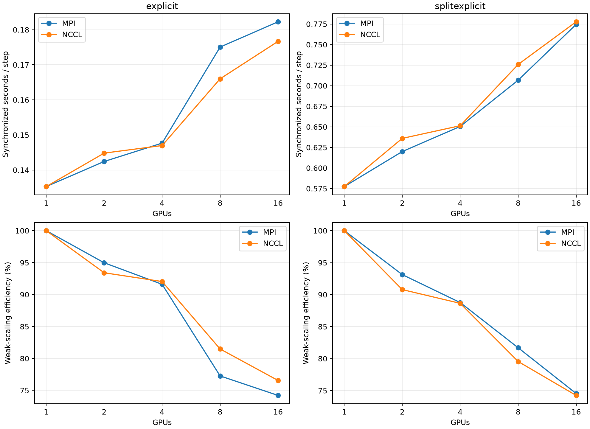

# Rorqual compressible MPI/NCCL weak scaling

**18/18 cases validated.** See [progress](progress.json) and [case plan](plan.json).

Full dry CBL, Float32, WENO5, fixed 12 km × 12 km × 3 km domain; both dynamics use the same Δt per grid.
10 warmup and 500 timed steps. Split-explicit uses 12 acoustic substeps. No Nsight runs.

| GPUs | Global grid | Partition | Backends | Δt (s) |
|---|---|---|---|---|
| 1 | 512×512×512 | 1×1×1 | Shared SERIAL | 0.01 |
| 2 | 1024×512×512 | 2×1×1 | MPI, NCCL | 0.005 |
| 4 | 1024×1024×512 | 4×1×1 | MPI, NCCL | 0.005 |
| 8 | 4096×512×512 | 8×1×1 | MPI, NCCL | 0.00125 |
| 16 | 8192×512×512 | 16×1×1 | MPI, NCCL | 0.000625 |

One 16-GPU/four-node Slurm allocation runs cases sequentially, one Julia thread per rank,
system CUDA-aware MPI and JULIA_CUDA_MEMORY_POOL=none. Each case has a 30-minute execution cap;
the allocation requests three hours based on previous stepping times plus compilation allowance.

Every accepted case requires finite prognostic and velocity fields on every rank, unique GPU placement,
the requested communicator, and positive finite timing. Timing uses the slowest synchronized rank.
Weak efficiency is 100 × serial seconds/step ÷ distributed seconds/step. Finiteness does not
establish agreement with a serial solution. Each grid advances 500 steps, so simulated durations vary with Δt.

[Source revision](provenance/source_commit.txt), [working-tree patch](provenance/source_changes.patch),
[frozen hashes](provenance/hashes.json), [environment setup](provenance/setup.log),
[manifest](provenance/Manifest.toml), and [source archive](provenance/source.tar.gz).
Per-case directories contain exact commands, environment records, per-rank logs, final device-memory
snapshots and sampled per-process GPU memory (MiB, every five seconds; sampled maxima can miss peaks).

| Case | State | s/step | Points/s | Weak efficiency |
|---|---|---|---|---|
| compressible_explicit_SERIAL_1g_1x1 | validated | 1.352631e-01 | 9.922714e+08 | 100.0 |
| compressible_explicit_MPI_2g_2x1 | validated | 1.424234e-01 | 1.884771e+09 | 94.9725255821726 |
| compressible_explicit_NCCL_2g_2x1 | validated | 1.448087e-01 | 1.853725e+09 | 93.40813086506542 |
| compressible_explicit_MPI_4g_4x1 | validated | 1.476638e-01 | 3.635764e+09 | 91.602071733221 |
| compressible_explicit_NCCL_4g_4x1 | validated | 1.469693e-01 | 3.652947e+09 | 92.03493518714453 |
| compressible_explicit_MPI_8g_8x1 | validated | 1.750560e-01 | 6.133705e+09 | 77.26847408829175 |
| compressible_explicit_NCCL_8g_8x1 | validated | 1.659975e-01 | 6.468421e+09 | 81.48502236479466 |
| compressible_explicit_MPI_16g_16x1 | validated | 1.822617e-01 | 1.178242e+10 | 74.21367187950074 |
| compressible_explicit_NCCL_16g_16x1 | validated | 1.766848e-01 | 1.215432e+10 | 76.55616102800015 |
| compressible_splitexplicit_SERIAL_1g_1x1 | validated | 5.773748e-01 | 2.324620e+08 | 100.0 |
| compressible_splitexplicit_MPI_2g_2x1 | validated | 6.199716e-01 | 4.329802e+08 | 93.12923366167095 |
| compressible_splitexplicit_NCCL_2g_2x1 | validated | 6.359811e-01 | 4.220809e+08 | 90.7848991109956 |
| compressible_splitexplicit_MPI_4g_4x1 | validated | 6.505168e-01 | 8.252991e+08 | 88.75632420254173 |
| compressible_splitexplicit_NCCL_4g_4x1 | validated | 6.514045e-01 | 8.241744e+08 | 88.6353717237139 |
| compressible_splitexplicit_MPI_8g_8x1 | validated | 7.068041e-01 | 1.519150e+09 | 81.68809433901133 |
| compressible_splitexplicit_NCCL_8g_8x1 | validated | 7.258972e-01 | 1.479193e+09 | 79.53947198032999 |
| compressible_splitexplicit_MPI_16g_16x1 | validated | 7.745832e-01 | 2.772438e+09 | 74.54006231996769 |
| compressible_splitexplicit_NCCL_16g_16x1 | validated | 7.777252e-01 | 2.761237e+09 | 74.23892140823006 |

