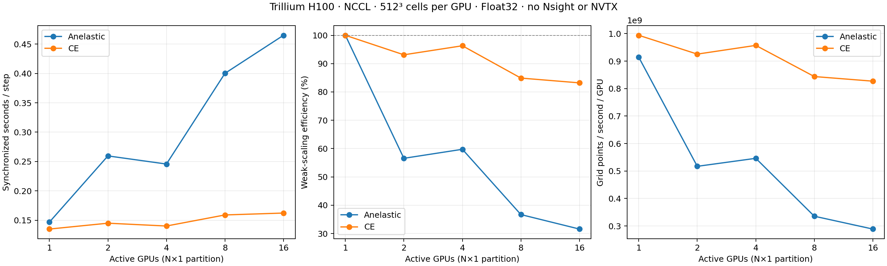

# Trillium NCCL weak scaling: anelastic and CE

Status: **VALIDATED; 10/10 cases validated.** Pending, failed, and unrun cases are excluded from performance metrics.

Full dry convective boundary layer, WENO5, Float32, deterministic smooth initial perturbations.
Fixed 12 km × 12 km × 3 km domain; N×1 partitions and 512³ cells per GPU.
Anelastic and CE halve Δt with each doubling of GPU count. CE is compressible explicit.
Multi-GPU runs exchange halos (and transpose the anelastic FFT pressure solve) with NCCL; MPI only launches ranks and times steps.
10 untimed warmup steps and 500 timed steps per case, one timed window.
**Pure performance benchmark: no Nsight capture and no NVTX instrumentation** (`--profile=false --nvtx=false`).
One Julia/BLAS/OpenMP thread per rank; CUDA memory pool disabled.

| GPUs | Global grid | Partition | Backend | Δt (s) |
|---:|---|---|---|---:|
| 1 | 512×512×512 | 1×1 | SERIAL | 0.01 |
| 2 | 1024×512×512 | 2×1 | NCCL | 0.005 |
| 4 | 2048×512×512 | 4×1 | NCCL | 0.0025 |
| 8 | 4096×512×512 | 8×1 | NCCL | 0.00125 |
| 16 | 8192×512×512 | 16×1 | NCCL | 0.000625 |

GPU counts and per-GPU throughput refer to active MPI ranks, with one selected GPU per rank.
One Slurm allocation per GPU count runs its cases sequentially, with 24 CPU cores per rank and one Julia thread.
The two-GPU allocation reserves all four H100s of one node so both ranks see every device (GPU peer copies); Trillium allocates only 1 GPU or whole 4-GPU nodes;
only two ranks and two GPUs run the benchmark, and the unused GPUs are excluded from throughput and efficiency.
Each allocation has a three-hour limit; each case has a 50-minute cap, including startup and compilation.
A login-node watcher (publish_when_done.sh) finalizes and publishes once every allocation has left the queue.

| GPUs | Slurm job |
|---:|---|
| 1 | 1413542 |
| 2 | 1413543 |
| 4 | 1413544 |
| 8 | 1413545 |
| 16 | 1413546 |

Finalizer job: none (login-node publication). Exact submission commands are in [submission.json](submission.json) and [allocations/](allocations/).

| Dynamics | GPUs | State | s/step | Points/s/GPU | Weak efficiency (%) | Evidence / error |
|---|---:|---|---:|---:|---:|---|
| Anelastic | 1 | validated | 1.468248e-01 | 914135400.0 | 100.0 | [case files](cases/anelastic_SERIAL_1g_1x1/) |
| CE | 1 | validated | 1.350299e-01 | 993985100.0 | 100.0 | [case files](cases/compressible_explicit_SERIAL_1g_1x1/) |
| Anelastic | 2 | validated | 2.595917e-01 | 517034000.0 | 56.55989771629833 | [case files](cases/anelastic_NCCL_2g_2x1/) |
| CE | 2 | validated | 1.450151e-01 | 925543500.0 | 93.1143722274439 | [case files](cases/compressible_explicit_NCCL_2g_2x1/) |
| Anelastic | 4 | validated | 2.457380e-01 | 546182250.0 | 59.74851264354719 | [case files](cases/anelastic_NCCL_4g_4x1/) |
| CE | 4 | validated | 1.402076e-01 | 957278750.0 | 96.3071188723008 | [case files](cases/compressible_explicit_NCCL_4g_4x1/) |
| Anelastic | 8 | validated | 4.001752e-01 | 335397500.0 | 36.69012972318124 | [case files](cases/anelastic_NCCL_8g_8x1/) |
| CE | 8 | validated | 1.590565e-01 | 843836625.0 | 84.89429856686147 | [case files](cases/compressible_explicit_NCCL_8g_8x1/) |
| Anelastic | 16 | validated | 4.649553e-01 | 288668062.5 | 31.578261394159824 | [case files](cases/anelastic_NCCL_16g_16x1/) |
| CE | 16 | validated | 1.622855e-01 | 827046875.0 | 83.20515388004473 | [case files](cases/compressible_explicit_NCCL_16g_16x1/) |

Timing includes final GPU synchronization and an MPI barrier and uses the slowest rank.
Weak efficiency is 100 × serial seconds/step ÷ distributed seconds/step, using a separate serial baseline for each dynamics.
The fixed physical domain becomes finer in x as GPU count increases. These are step-throughput measurements at constant cells per GPU; simulated durations decrease with Δt.
Every accepted measurement requires the planned grid/dynamics/precision, distinct H100 GPU placement, the expected MPI or NCCL communicator, positive finite timing, and finite prognostic and velocity fields on every rank.
Finite fields do not establish full numerical agreement with serial solutions. One timed window supplies no repeat-to-repeat uncertainty estimate.

[Source commit](provenance/source_commit.txt), [source archive](provenance/source.tar.gz), [frozen hashes](provenance/hashes.json),
[Julia environment](provenance/Manifest.toml), [MPI preferences](provenance/LocalPreferences.toml), [setup log](provenance/setup.log), and [case plan](plan.json).
Per-case directories retain exact commands, every rank's log and field validation, hardware details, final device-memory use, and five-second process-memory samples (which can miss peaks).

Julia 1.12.5; Breeze 0.15.0, Oceananigans 0.117.2, CUDA 6.4.2, MPI 0.20.29.

[Comparison CSV](comparison.csv) · [Vector SVG](weak_scaling.svg)

### Efficiency against Fir MPI

Solid lines are this study; dashed lines are the Fir MPI N×1 study
([`../../fir/weak_scaling_mpi_2026-11-12_nx1`](../../fir/weak_scaling_mpi_2026-11-12_nx1/README.md)).
Each curve is normalized to its own one-GPU baseline. Regenerate with `python3 plot_efficiency.py`.
[Vector SVG](weak_scaling_efficiency.svg)
