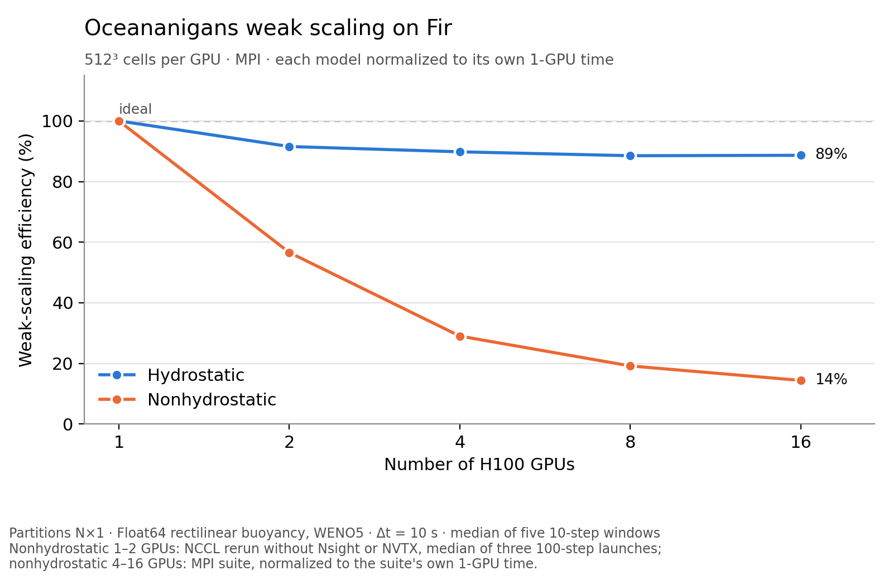
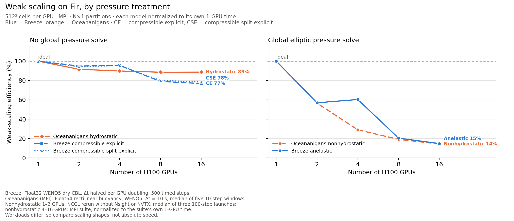
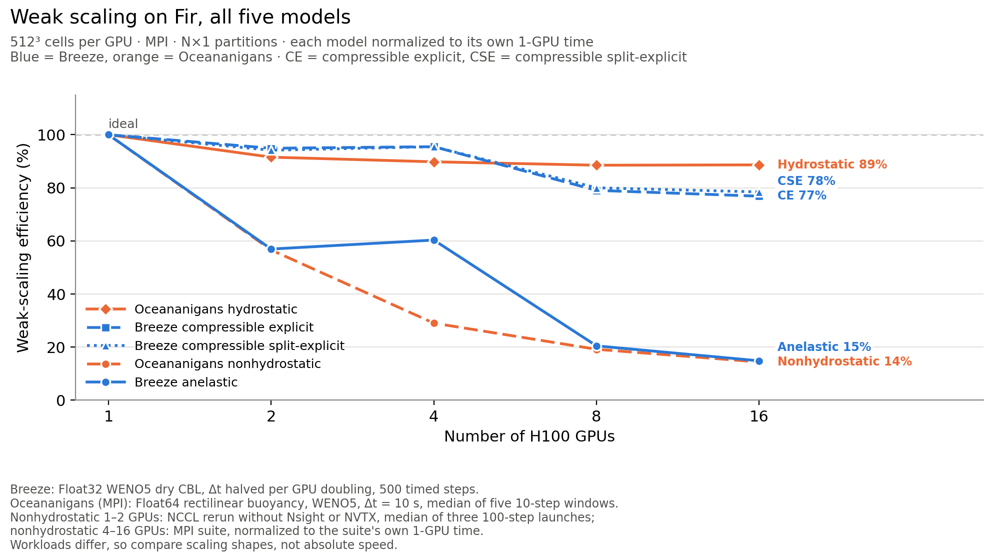

# Weak-scaling efficiency at 512³ cells per GPU

Efficiency is **100 × T₁ / Tₙ**, with T in seconds per step and each model normalized
to its own one-GPU time. Local grids stay at 512³ cells; the global grid grows in x.
Ideal weak scaling is 100%. Each point is one measured window; no error bars are implied.
`plot_weak_efficiency.py` regenerates every figure and `weak_efficiency.csv` from the
source measurements below; it skips a figure whose series is incomplete.

Each figure covers one machine. Rondeau uses A100 GPUs and Fir uses H100 GPUs, whose
compute, memory bandwidth and interconnect differ, so neither timings nor efficiencies
are comparable between Rondeau and Fir figures. Compare models only within one figure.

## Breeze: anelastic, compressible explicit, compressible split-explicit

Fir, 1–16 H100s, N×1 partitions, one validated series from
[fir/weak_scaling_mpi_2026-11-12_nx1](../fir/weak_scaling_mpi_2026-11-12_nx1/README.md).
Float32 WENO5 dry CBL, Δt halved per GPU doubling, 500 timed steps, slowest-rank time.

| GPUs | Anelastic | Compressible explicit | Compressible split-explicit |
|---:|---:|---:|---:|
| 2 | 56.9% | 94.9% | 94.2% |
| 4 | 60.3% | 95.5% | 95.5% |
| 8 | 20.5% | 79.0% | 80.0% |
| 16 | 14.8% | 76.9% | 78.5% |

Rondeau, 1–4 A100s, Δt = 0.005 s at every count. Anelastic is from
[anelastic_weak_scaling_512_2026-11-13](../rondeau/anelastic_weak_scaling_512_2026-11-13/README.md)
(4×1 at four GPUs). Compressible MPI values are the 9–10 November measurements from
[weak_scaling_mpi_nccl_2026-11-09_dt0p005](../rondeau/weak_scaling_mpi_nccl_2026-11-09_dt0p005/README.md),
using 2×2 at four GPUs so each local grid is a 512³ cube. The two studies use different
source revisions, so compare scaling shapes, not absolute costs.

| GPUs | Anelastic | Compressible explicit | Compressible split-explicit |
|---:|---:|---:|---:|
| 2 | 63.6% | 97.8% | 96.0% |
| 4 | 57.8% | 91.5% | 82.4% |

## Oceananigans: hydrostatic and nonhydrostatic

Fir, 1–16 H100s, from the Oceananigans `gpu_weak_scaling_512_x` baseline series
(`/u/ajtse/Oceananigans.jl/benchmarking/results/<model>/fir/baseline/gpu_weak_scaling_512_x/`).
Float64 RectilinearGrid, periodic x/y, WENO5, one buoyancy tracer, Δt = 10 s, N×1 partitions.
The hydrostatic model uses a split-explicit free surface; the nonhydrostatic model uses the
distributed FFT pressure solver. Times are the median of five ten-step windows (slowest rank).

| GPUs | Hydrostatic | Nonhydrostatic |
|---:|---:|---:|
| 2 | 91.5% | 40.0% |
| 4 | 89.8% | 29.0% |
| 8 | 88.5% | 19.2% |
| 16 | 88.6% | 14.4% |

The Breeze and Oceananigans workloads differ (Float32 atmosphere vs Float64 ocean
buoyancy case), so the figures compare each code's scaling, not their absolute speed.

### Rondeau

Status: **RUNNING**. The same Oceananigans workload on 1, 2 and 4 Rondeau A100s
(`benchmarking/server/rondeau/weak512_config.json` in Oceananigans, commit 20c72c03c)
was started on 15 November. The local backend waits for GPUs with no other processes,
so the four-GPU cases start only when the other users' jobs leave GPUs 1 and 3.

Study: `/u/ajtse/Oceananigans.jl/.runtime/studies/2026-11-15_rondeau_weak512`.
Watcher log: `/u/ajtse/Breeze.jl/.runtime/weak_scaling_efficiency_2026-11-15/watcher.log`.
When the study exits, the watcher reruns `plot_weak_efficiency.py`; if both Rondeau series
are complete it adds `oceananigans_weak_efficiency_rondeau.png/.svg`, updates this status,
then commits and pushes this directory to `benchmark-results`.

## Cross-code comparisons on Fir

Same Fir data as above (H100, 1–16 GPUs, N×1). In these figures color encodes the code
(blue Breeze, orange Oceananigans) and line style plus marker encode the model, so each
model looks the same in every panel. CE is compressible explicit, CSE compressible split-explicit.
The workloads differ, so compare scaling shapes, not absolute speed.

1. **By code**: Oceananigans (hydrostatic, nonhydrostatic) beside Breeze (anelastic, CE, CSE).

   

2. **By pressure treatment**: models with no global pressure solve (hydrostatic, CE, CSE)
   beside models with a global elliptic pressure solve (nonhydrostatic, anelastic).

   

3. **All five models** in one panel.

   

## Cross-code comparisons on Rondeau

The same three sets for Rondeau (A100, 1–4 GPUs), drawn from the Rondeau data above. Breeze
compressible uses 2×2 at four GPUs, and its anelastic and compressible runs come from different
source revisions. **The Oceananigans lines stop at 2 GPUs for now**: the four-GPU cases have not
started because other users' jobs occupy the GPUs (see the Oceananigans Rondeau status above).
When the study finishes, the watcher reruns the script, which redraws these figures with the
four-GPU points and commits them. Do not compare these figures with the Fir figures.

1. **By code**

   

2. **By pressure treatment**

   

3. **All five models**

   
